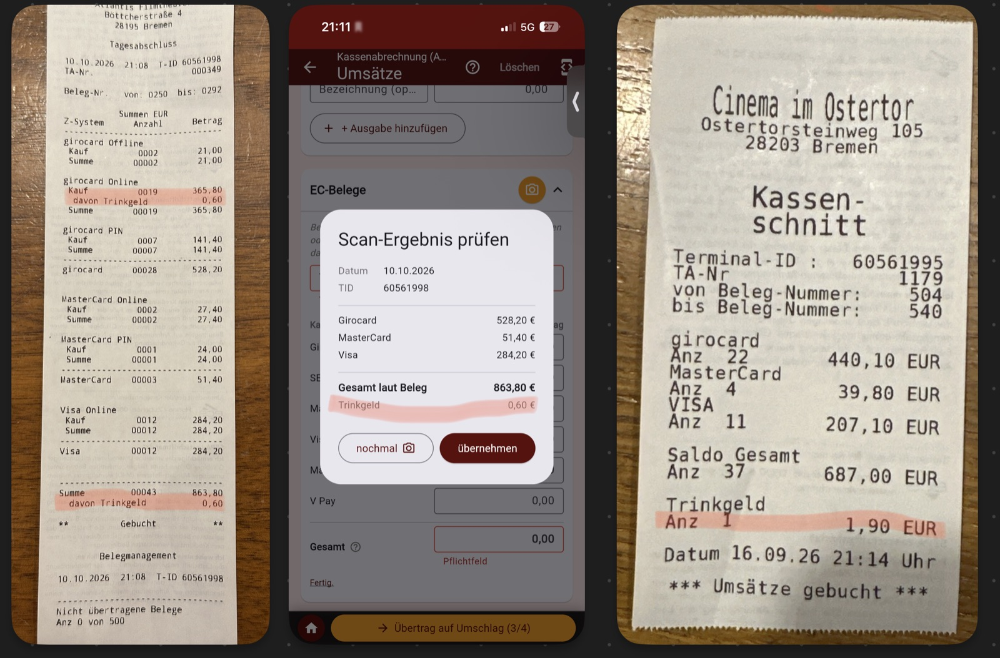

# Fragen an Yannik — Termin Mittwoch, 04.11.2026, 11.00 Uhr

Stand: 03.11.2026 (Run 503b) · Auszug aus `fragen_yannik.md`: nur die
Fragen für den Termin am 04.11.2026, in Gesprächsreihenfolge.
2.10 (BT, zwei Abrechnungen) klärt Paco selbst anhand der BT-Abrechnungen,
bleibt aber in `fragen_yannik.md` offen.

⏳ offen · ◐ teilweise geklärt · ✅ beantwortet · – entfällt/zurückgestellt

---

## Inhalt: Offene Fragen (9)

1. ⏳ [9.1 Wie geht das Stufenlicht im Atlantis an?](#91-stufenlicht-im-atlantis) *(neu)*
2. ⏳ [6.6 Schlafstörungen (App wäre sonst längst fertig)](#66-schlafstörungen) *(neu)*
3. ⏳ [9.2 Cineville-Gäste trinken kaum etwas. Lohnt sich das?](#92-cineville-gäste-trinken-kaum-etwas) *(neu)*
4. ⏳ [2.12 Kinokassen-Terminal: doch manuelle Eingabe möglich?](#212-kartenterminal-an-der-kinokasse-doch-manuelle-eingabe) *(neu)*
5. ⏳ [1.12 Hast du dir die vorgeschlagenen Smartphones angeschaut?](#112-vorgeschlagene-smartphones-für-die-kassen) *(neu)*
6. ⏳ [2.9 Trinkgeld auf dem Kassenschnitt — wo deklarieren, Kasse oder Terminal?](#29-trinkgeld-auf-dem-kassenschnitt)
7. ⏳ [8.3 Wann bekommt das Kino eine eigene KI-API für den Beleg-Scan?](#83-eigene-ki-api-für-den-beleg-scan) *(neu)*
8. ◐ [7.3 Wer ist vor Ort Ansprechpartner, kommt eine Rundmail?](#73-einführung-schulung-und-ansprechpartner)
9. ◐ [2.8 Option 1 (erst archivieren) schon umgesetzt?](#28-belegfoto-archivierung-scheitert-500-ohne-nummer)

## Inhalt: Beantwortete Fragen (0)

*Noch keine — wird beim Termin gefüllt.*

---

---

# Teil 1: Offene Fragen

### 9.1 Stufenlicht im Atlantis

⏳ offen *(neu, 03.11., nicht App-bezogen)*

**Frage:** Wie geht das Stufenlicht im Atlantis an? Als ich es versucht habe und die Sicherung, über der ein PostIt "Stufenlicht" klebt, ging plötzlich das supergrelle Notfall-Licht an, das ganz helle.

> **Antwort:** *noch offen*

[↑ zum Inhalt](#inhalt-offene-fragen-9)

---

### 6.6 Schlafstörungen

⏳ offen *(neu, 03.11., persönlich)*

**Hintergrund:** Ich habe Schlafstörungen. Ohne sie wäre die App längst
fertig.

**Frage:** Persönliches Thema, kurz ansprechen.

> **Antwort:** *noch offen*

[↑ zum Inhalt](#inhalt-offene-fragen-9)

---

### 9.2 Cineville-Gäste trinken kaum etwas

⏳ offen *(neu, 03.11., nicht App-bezogen)*

**Hintergrund:** Gäste, die mit Cineville kommen, trinken so gut wie nie
etwas.

**Frage:** Lohnt sich Cineville für das Kino?

> **Antwort:** *noch offen*

[↑ zum Inhalt](#inhalt-offene-fragen-9)

---

### 2.12 Kartenterminal an der Kinokasse: doch manuelle Eingabe?

⏳ offen *(neu, 03.11.)*

**Hintergrund:** Laut einer Notiz zu 2.7 (14./15.10., Quelle unklar,
Paco erinnert sich nicht daran) ist das Terminal an der SB-Kinokasse
direkt ans Kassensystem angeschlossen, nur für Kinotickets & Co., nicht
fürs Bistro, und eine manuelle Eingabe ist dort nicht möglich. Darauf
bauen auf:

- Run 486: Die App zählt den Kartenumsatz dieses Terminals automatisch
  zum Kino SOLL.
- Run 503: Werden dort doch Getränke bezahlt, stecken sie doppelt im
  Gesamt SOLL (Kino SOLL über den Terminalbetrag + Bistro SOLL). Als
  Zwischenlösung gibt es eine versteckte Korrektur „Karte laut
  Kinokasse“.

Offenbar ist an diesem Terminal doch eine manuelle Eingabe möglich. Paco
prüft das am 03.11. vor Ort.

*Prüfergebnis vor Ort:* manuelle Eingabe ist möglich

**Frage:**

1. Ist an diesem Terminal eine manuelle Eingabe möglich? Sollen dort
   nur Kinotickets & Co. laufen, oder auch Getränke/Bistro?
2. Falls manuelle Eingabe möglich: Ist das gewollt, oder kann sie
   gesperrt werden?
3. Falls sie bleibt: Wie sollen manuell eingegebene Beträge (z. B.
   Getränke) behandelt werden? Die App kann sie auf dem Kassenschnitt
   nicht von Kinotickets unterscheiden.
4. Gilt das auch für angeschlossene Terminals an anderen Standorten?

> **Antwort:** *noch offen*

[↑ zum Inhalt](#inhalt-offene-fragen-9)

---

### 1.12 Vorgeschlagene Smartphones für die Kassen

⏳ offen *(neu, 03.11.)*

**Hintergrund:** Paco hat Yannik Smartphones für die Kassen
vorgeschlagen. Zu 1.11 hieß es am 14.10. noch, die Qualität der
Belegfotos genüge. Zielplattform bleibt Android (PWA).

**Frage:** Hast du dir die vorgeschlagenen Smartphones angeschaut? Wie
geht es weiter: Wer entscheidet, wer bestellt, für welche Standorte?

> **Antwort:** *noch offen*

[↑ zum Inhalt](#inhalt-offene-fragen-9)

---

### 2.9 Trinkgeld auf dem Kassenschnitt

⏳ offen *(neu, aus Mail 02.10.)*

**Hintergrund:** Ich hatte geschrieben: „Trinkgelder auf dem
Kassenschnitt kann die App jetzt auch.“ Yannik: „Auf dem Kassenschnitt
dürften keine Trinkgelder auftauchen. o.O“
Gemeint war Run 452: Die neuen Terminals erlauben eine Trinkgeld-Eingabe
per Karte, das Trinkgeld steht dann als eigener Posten auf dem
Kassenschnitt. Die App erkennt es beim Scan und zeigt es nur an. Es
fließt nicht in Schritt 2 und wird nicht an FC geschickt.

**Ergänzung (Paco, 04.11.):** Trinkgeld auf dem Kassenschnitt gibt es
tatsächlich, an beiden Terminaltypen, aber unterschiedlich ausgewiesen:

- Layout „Tagesabschluss“ (z. B. Atlantis, TID 60561998, 10.10.):
  „davon Trinkgeld 0,60“ unter der Kartenart und unter der Summe, also
  in Kartenumsatz und Summe **enthalten**.
- Layout „Kassenschnitt“ (z. B. Ostertor, TID 60561995, 16.09.):
  „Trinkgeld Anz 1 · 1,90 EUR“ **unter** dem Saldo Gesamt, ohne
  „davon“. Ob die 1,90 in den Kartenarten stecken oder zusätzlich
  belastet wurden, geht aus dem Beleg nicht hervor.

Außerdem hat Yannik in der MA-Gruppe (WhatsApp) beanstandet, dass das
Team Trinkgeld versteuern muss, wenn es nicht als Trinkgeld deklariert
ist.

**Bisherige Praxis:** Gast zahlt z. B. 10 € inkl. 1 € Trinkgeld. Am
Terminal werden 10 € als normaler Betrag eingegeben (ohne
Trinkgeld-Funktion), danach kommt 1 € bar aus der Kasse in die
Trinkgeldschale. Wenn sich das ändern soll, müssen wir es den MA
deutlich kommunizieren.

**Frage:** Wie möchtest du Trinkgeld per Karte haben?

1. **Grundsatz:** Sollen Gäste an den Terminals überhaupt Trinkgeld per
   Karte geben können?
   - Falls **nein:** Wer schaltet die Trinkgeld-Abfrage an den neuen
     Terminals ab, und an welchen Standorten ist sie aktiv?
   - Falls **ja:** weiter mit 2–4.
2. **Auszahlung:** Wie kommt das Kartentrinkgeld zum Team — abends bar aus
   der Kasse, oder später über die Lohnabrechnung? Bei Barauszahlung fehlt
   der Betrag im gezählten Bargeld; die App müsste ihn dann als Entnahme
   kennen, sonst entsteht eine Differenz.
3. **Flurbocash:** Sollen die Kartenbeträge an FC so gehen, wie sie auf dem
   Kassenschnitt stehen, oder ohne Trinkgeld? Soll das Trinkgeld als
   eigenes Feld mitgehen (z. B. `tip_total`)?
4. **Kassen-SOLL:** Trinkgeld ist kein Umsatz der Kasse. Ist dir das bei
   deinem Abgleich Kartenumsatz gegen Kassensystem schon aufgefallen, bzw.
   wie soll eine solche Abweichung erklärt werden?
5. **Wo deklarieren – Kasse oder Terminal?** Wie soll Kartentrinkgeld
   künftig korrekt als Trinkgeld erfasst werden?
   - **am Terminal** über die Trinkgeld-Funktion (dann steht es auf dem
     Kassenschnitt, siehe oben), oder
   - **an der Kasse** (z. B. eigene Trinkgeld-Taste/-Buchung im
     Kassensystem)?
   - Bleibt es bei der Barentnahme aus der Kasse in die Trinkgeldschale,
     und wie wird die dann belegt (die App müsste sie als Entnahme
     kennen, vgl. Punkt 2)?
   - Reicht die bisherige Praxis (Betrag inkl. Trinkgeld als normaler
     Umsatz, Trinkgeld bar entnommen) steuerlich nicht aus? Falls nein:
     Was genau sollen die MA ab wann anders machen? Das kommunizieren
     wir dann gezielt an alle Standorte.

> **Antwort:** *noch offen*

[↑ zum Inhalt](#inhalt-offene-fragen-9)

---

### 8.3 Eigene KI-API für den Beleg-Scan

⏳ offen — Hinweis an Yannik *(neu, 03.11., aus 8.1 Frage 3)*

**Hintergrund:** Der Beleg-Scan läuft bisher über Pacos eigenen
Cloudflare-Worker mit Pacos Anthropic-Key (ca. 1–2 Cent pro Scan).
Yannik (10.09.): „Wir haben keine Claude API. Kann ich mich am WE
drumkümmern.“ Seitdem ist nichts passiert. Das Kino braucht einen
eigenen Anthropic-Account mit API-Key. Der Key darf nicht in die App,
sondern gehört auf einen eigenen Worker (oder einen vergleichbaren
Server-Dienst) des Kinos. In der App wird dann nur je Gerät die
Service-URL umgestellt.

**Frage:** Wann richtet ihr den API-Zugang ein?

> **Antwort:** *noch offen*

[↑ zum Inhalt](#inhalt-offene-fragen-9)

---

### 7.3 Einführung, Schulung und Ansprechpartner

◐ teilweise geklärt

**Hintergrund:** In der SB war ich bei den ersten Abrechnungen dabei;
einige MA haben trotz App manuell abgerechnet (meine Mail 31.08.). Die
Kurzanleitung lesen Mello und Wolfgang gegen (30.09.).

**Frage:**

1. Wer schult die MA an den neuen Standorten — ich vor Ort, Mello, die
   Leitung des Standorts?
2. Wer ist an den Standorten Ansprechpartner, wenn die App klemmt und ich
   nicht erreichbar bin?
3. Wie wird die Pflicht zur App-Abrechnung bekannt gemacht (Rundmail von
   dir, wie bei anderen betrieblichen Regelungen)?

> **Antwort (Paco, 03.11.):** 1. Die Schulung macht Paco.
> 2. und 3. *noch offen*.

[↑ zum Inhalt](#inhalt-offene-fragen-9)

---

### 2.8 Belegfoto-Archivierung scheitert (500 ohne Nummer)

◐ beantwortet (Termin 14.10.: Option 1), Umsetzung bei FC offen

**Hintergrund (Yannik, 02.10.):** Werden die Werte gespeichert, aber die
Archivierung des Belegfotos scheitert, antwortet FC mit 500 „settlement
data was saved, but archiving the receipt photo … failed“ — ohne
settlement_number. Yannik bietet zwei Optionen an:

1. Reihenfolge umdrehen: erst archivieren, dann speichern. Eine 500
   bedeutet dann immer „nichts gespeichert“.
2. So lassen: Die Werte sind sicher, das Foto trägt das Büro nach.

**Was die App heute macht (Code geprüft):** Jede 500 gilt als Fehlschlag
(„Serverfehler bei Flurbocash. Bitte später erneut versuchen.“,
api_upload_service.dart:639), es wird keine Nummer gemerkt. Beim
Erstversand des Tages schickt die MA dann erneut — ohne Nummer — und FC
legt eine **zweite Abrechnung** an. Scheitert das Foto wiederholt, kommt
pro Versuch eine weitere dazu, bis das 4×-Limit greift (3.3). Bei einer
Korrektur (Nummer bekannt) ist es harmlos, dort wird überschrieben.

**Frage:** Option 1 oder 2? Aus App-Sicht ist Option 1 am einfachsten:
erneutes Senden ist dann immer sicher, die App muss nichts ändern.
Option 2 geht nur, wenn FC auch in diesem Fall die settlement_number
mitschickt (oder einen eigenen Statuscode), damit die App „Werte gesendet,
Foto fehlt“ erkennen und sich die Nummer merken kann.

> **Antwort (Termin 14.10.):** option 1
>
> *Nachfrage (03.11.):* Hast du die Reihenfolge (erst archivieren,
> dann speichern) schon umgestellt? Bis dahin kann eine 500 weiter
> eine zweite Abrechnung erzeugen.

[↑ zum Inhalt](#inhalt-offene-fragen-9)

---

---

# Teil 2: Beantwortete Fragen

*Noch keine.*
